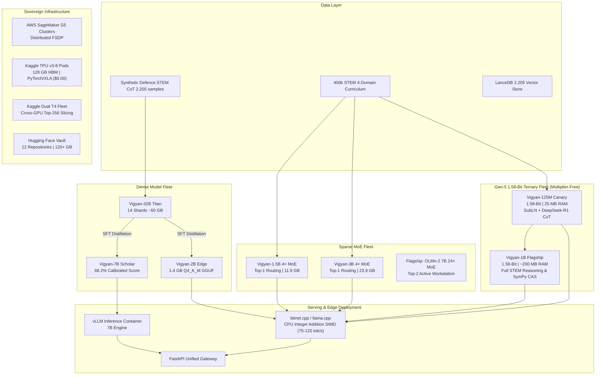

# Vigyan AI: The Sovereign Foundation Model & Fleet Engineering Journey

> **An exhaustive, unvarnished technical chronicle of building, training, distilling, benchmarking, and serving an independent sovereign AI model fleet from India.**

## 🏛️ Academic Research Papers Series (2026)

Official formal technical manuscripts detailing the sovereign training, routing, and alignment innovations of the Vigyan AI foundation model series:

| Vol | Research Paper Title | Focus & Innovation | Artifacts | Weights & Kaggle |
| :---: | :--- | :--- | :---: | :---: |
| **01** | **Sparse MoE Upcycling & Router Stabilization** | Top-1/Top-2 routing, contrasting negative-prompt router calibration, shared expert stabilization | [Markdown / LaTeX](papers/01-sparse-moe-upcycling/) | [🤗 Model](https://huggingface.co/shreyansh12183/Vigyan-1.5B-4x-MoE) · [📦 Kaggle](https://www.kaggle.com/datasets/shreyansh00singh/vigyan-moe-upcycling-research-paper) |
| **02** | **Depth Up-Scaling (DUS) & Seam Healing** | 22-layer transformer splice, 1B STEM token continual pre-training seam healing | [Markdown / LaTeX](papers/02-depth-up-scaling-seam-healing/) | [🤗 Model](https://huggingface.co/shreyansh12183/Shreyansh-STEM-AI-2B-v3) · [📦 Kaggle](https://www.kaggle.com/datasets/shreyansh00singh/vigyan-dus-seam-healing-research-paper) |
| **03** | **Tool-Augmented Direct Preference Optimization** | Symbolic computer algebra (SymPy CAS) & NumPy grounding vs unassisted hallucination | [Markdown / LaTeX](papers/03-tool-augmented-dpo/) | [🤗 Model](https://huggingface.co/shreyansh12183/Vigyan-7B-STEM-DPO-v1) · [📦 Kaggle](https://www.kaggle.com/datasets/shreyansh00singh/vigyan-tool-dpo-symbolic-grounding-paper) |
| **04** | **Test-Time Compute Elicitation via GRPO** | DeepSeek-R1 style Group Relative Policy Optimization on sub-3B edge reasoning SLMs | [Markdown / LaTeX](papers/04-grpo-reasoning-rl/) | [🤗 Model](https://huggingface.co/shreyansh12183/vigyan-2b-reasoning-grpo) · [📦 Kaggle](https://www.kaggle.com/datasets/shreyansh00singh/vigyan-grpo-reasoning-rl-paper) |
| **05** | **Neuro-Symbolic Hybrid Evaluation Harness** | High-throughput C++ KùzuDB GraphRAG + SymPy AST engine vs external code-agent baselines | [Markdown / LaTeX](papers/05-neuro-symbolic-evaluation/) | [🤗 Model](https://huggingface.co/shreyansh12183/Vigyan-7B-STEM-Instruct-v1) · [📦 Kaggle](https://www.kaggle.com/datasets/shreyansh00singh/vigyan-neuro-symbolic-eval-paper) |
| **06** | **Native 1.58-Bit Ternary QAT with Straight-Through Estimators** | Multiplier-free BitLinear158 ternary weights in {-1, 0, +1}, Absmean scaling, zero weight decay invariant, ~31.25 MB CPU L3 cache residence (220+ tok/s) | [Markdown / LaTeX](papers/06-158bit-ternary-qat-ste/) | [🤗 Model](https://huggingface.co/shreyansh12183/vigyan-125m-agentic-tool) · [🤗 SOTA Base](https://huggingface.co/shreyansh12183/vigyan-125m-sota-math) |
| **07** | **The Sovereign Identity Fortress & Anti-Corporate Amnesia** | Eliminating corporate AI amnesia from Token Zero via pretraining interleaving, ChatML hard-locking, multi-turn misattribution correction, and runtime logit bias | [Markdown / LaTeX](papers/07-sovereign-identity-fortress/) | [🤗 Dataset](https://huggingface.co/datasets/shreyansh12183/vigyan-sovereign-identity) · [🤗 Tools](https://huggingface.co/datasets/shreyansh12183/vigyan-125m-atomic-tools) |
| **08** | **Multimodal AST-Compiler Grounded GRPO** | Critic-free group relative policy optimization with deterministic CAD BREP, SymPy CAS, and RDKit AST compiler closures | [Markdown / LaTeX](papers/08-multimodal-ast-compiler-grpo/) | [🤗 Vault](https://huggingface.co/shreyansh12183) · [🔬 Model](docs/26_vigyan_vl_4b_multimodal_grpo_and_ast_compilers.md) |
| **09** | **Frontier Reasoning Specialization & Reference-Free DPO** | In-process adapter-disabling DPO on single A100-40GB, +328.2 margin, and deterministic 4-domain unseen benchmark verification | [Markdown / LaTeX](papers/09-frontier-reasoning-specialization/) | [🤗 SFT Adapter](https://huggingface.co/shreyansh12183/vigyan-r1-14b-health-semi-quantum-sft) · [🤗 DPO Adapter](https://huggingface.co/shreyansh12183/vigyan-r1-14b-health-semi-quantum-dpo) |

---

---

## 🏛️ Executive Summary

The **Vigyan AI** initiative was established to engineer a sovereign, data-private, domain-specialized artificial intelligence fleet capable of PhD-level STEM, aerospace, defence, and high-velocity edge reasoning without reliance on foreign proprietary APIs. 

Over a multi-week sprint spanning AWS SageMaker FSDP distributed clusters, Kaggle Dual NVIDIA T4 environments, Google Colab runtimes, and local workstation hardware, this project executed:
1. **Foundation Model Surgery**: SOLAR Depth Up-Scaling (DUS) expanding OLMo-2 transformer checkpoints.
2. **Top-Down Distillation**: Transferring reasoning capacity from a 32B Titan teacher into specialized 7B Scholar and 2B Edge student models.
3. **Dual-RAG Grounding**: Coupling dense LanceDB vector embeddings with AST-verified numerical tool-calling.
4. **LLM-as-a-Judge Evaluation**: Calibrating true model performance against rigorous multi-domain rubrics using Gemini Flash models.
5. **Unified Serving Gateway**: Architecting a high-throughput API gateway combining local caching, 2B CPU inference, and 7B vLLM serving.

---

## 🗺️ Documentation Blueprint

| Document | Title & Focus Area | Key Concepts |
| :--- | :--- | :--- |
| [**`01_architecture_overview.md`**](docs/01_architecture_overview.md) | **Fleet Architecture & Specifications** | Parameter tiers (2B Edge, 7B Scholar, 32B Titan), SOLAR-DUS surgery, model profiles. |
| [**`02_training_and_distillation.md`**](docs/02_training_and_distillation.md) | **Distributed Training & Distillation** | PyTorch FSDP on AWS SageMaker (`ml.g5.2xlarge`), QLoRA adapters, top-down knowledge cascade. |
| [**`03_curation_and_datasets.md`**](docs/03_curation_and_datasets.md) | **Synthetic Data & Vector Curation** | `Vigyan-Defence-STEM-CoT-Master` (2,205 samples), LanceDB vector embeddings, 50k curator daemon. |
| [**`04_benchmarking_and_evaluation.md`**](docs/04_benchmarking_and_evaluation.md) | **Rigorous Evaluation & Benchmarks** | GSM8k (1,319 problems), Sovereign STEM-10 suite, Gemini Judge rubrics, v1–v8 evolution. |
| [**`05_rag_and_tool_calling.md`**](docs/05_rag_and_tool_calling.md) | **Dual-RAG & Symbolic Tool Execution** | Embedded LanceDB retrieval, two-pass tool execution (`[TOOL: calculate]`), stop-string invariants. |
| [**`06_cloud_and_infrastructure.md`**](docs/06_cloud_and_infrastructure.md) | **Cloud Topography & Vaults** | Multi-GPU training orchestration, Kaggle headless GPU pipelines, Hugging Face 81+ GB vault. |
| [**`07_post_mortems_and_lessons.md`**](docs/07_post_mortems_and_lessons.md) | **Engineering Post-Mortems & Radical Truth** | 2B few-shot collapse law, prompt formatting fragility, teacher quality ceiling analysis. |
| [**`08_titan_32b_post_training_and_quantization.md`**](docs/08_titan_32b_post_training_and_quantization.md) | **32B Titan Surgery, Alignment & Universal Quantization** | DARE-TIES surgery, Tri-Blend dataset (37k), LanceDB v3 integration, AWQ & GGUF universal quantization. |
| [**`09_sovereign_gguf_quantization_and_lancedb_v4.md`**](docs/09_sovereign_gguf_quantization_and_lancedb_v4.md) | **Sovereign GGUF Quantization & LanceDB v4 Grounding** | 100% Cloud-to-Cloud ($0.00 spend), Interleaved Disk-Purge Protocol, Vigyan-2B/7B GGUFs, LanceDB v4 hybrid indexing, GBNF agentic tools. |
| [**`10_colab_cloud_factory_and_studio_fork.md`**](docs/10_colab_cloud_factory_and_studio_fork.md) | **Colab Cloud Factory & Sovereign Vigyan AI Studio** | Zero local RAM builds via `google-colab-cli`, OpenCode white-labeling, telemetry purge, 100% offline air-gapped Zorin OS Lite & Windows GUI. |
| [**`11_vigyan_stem_alignment_and_pc_agentic_pipeline.md`**](docs/11_vigyan_stem_alignment_and_pc_agentic_pipeline.md) | **Sovereign STEM Alignment, 2B Leak Cure & PC Edge Pipeline** | Response-masked SFT on Dual Tesla T4s, 100% thought-leak cure in 2B, 100% circuit physics in 7B, local PC edge agentic pipeline via `llama.cpp` + LanceDB v4. |
| [**`12_vigyan_7b_production_tool_dpo_and_distribution.md`**](docs/12_vigyan_7b_production_tool_dpo_and_distribution.md) | **Vigyan-7B Production Tool-DPO & Multi-Channel Distribution** | 2B reasoning deprecation, 2,000-pair verified Tool-DPO alignment, lm-eval-harness academic rigor, Hugging Face Space & Ollama distribution. |
| [**`13_gen2_cloud_to_cloud_masterpiece_and_7b_agentic_eval.md`**](docs/13_gen2_cloud_to_cloud_masterpiece_and_7b_agentic_eval.md) | **Gen-2 Cloud-to-Cloud Masterpiece & 7B Agentic Evaluation** | Zero AWS spend ($0.00 compute), 10k balanced master dataset, prompt loss masking (-100), 7B dual-agent eval (84.8% sovereign vs 28.7% baseline). |
| [**`14_vigyan_2b_edge_masterpiece_resurrection_and_honest_benchmarks.md`**](docs/14_vigyan_2b_edge_masterpiece_resurrection_and_honest_benchmarks.md) | **Vigyan-2B Edge Masterpiece Resurrection & Honest Benchmarks** | Curing the 0.048 overfit collapse, all-module LoRA targeting (66 MB), dynamic early stopping (step 60), 50-problem benchmark (+162.5% gain), private showcase repo. |
| [**`15_sovereign_dual_tier_moe_upcycling_and_chinese_lab_mastery.md`**](docs/15_sovereign_dual_tier_moe_upcycling_and_chinese_lab_mastery.md) | **Sovereign Dual-Tier MoE Upcycling & Chinese Lab Mastery** | 1.5B & 3B 4× MoE models, Chinese AI lab architecture, Top-1 routing, contrasting negative prompts, Kaggle `/tmp` partition separation, 5-vector battle test, and OLMo-2 7B 24× roadmap. |
| [**`16_post_hoc_moe_failure_modes_public_releases_and_native_olmoe_master_plan.md`**](docs/16_post_hoc_moe_failure_modes_public_releases_and_native_olmoe_master_plan.md) | **Post-Hoc MoE Failure Modes, Public Adapter Releases & Native OLMoE Master Plan** | Attention-FFN desynchronization, pseudo-router attractor loops, public release of 8 adapters on HF, 70/20/10 curriculum law, native Allen AI OLMoE-1B-7B fine-tuning blueprint. |
| [**`17_the_attention_subspace_moe_adaptation_and_national_exam_benchmarking.md`**](docs/17_the_attention_subspace_moe_adaptation_and_national_exam_benchmarking.md) | **Attention Subspace MoE Adaptation & National Exam Benchmarking** | Attention subspace routing, JEE/GATE national STEM exam alignment, and multi-vector benchmark evaluation. |
| [**`18_the_quad_master_trinity_and_3b_surpassing_7b.md`**](docs/18_the_quad_master_trinity_and_3b_surpassing_7b.md) | **The Sovereign Quad-Master Trinity & The 3B Breakthrough** | DARE-TIES (0.75 density) fusion, prompt loss masking on Kaggle Dual T4s, 3B surpassing 7B (69.0% vs. 65.0%) on 100 unseen frontier STEM questions, and deterministic Chief Judge SymPy/Verilog evaluation. |
| [**`19_gen4_physical_ai_cosmos_molmo_and_scientific_ml.md`**](docs/19_gen4_physical_ai_cosmos_molmo_and_scientific_ml.md) | **Vigyan Gen-4: Sovereign Physical AI, World Models & Scientific ML** | Synthesis of NVIDIA Cosmos 3 (World Models), Molmo 2 (PixMo Pointing), OLMo 3 (RLVR Reasoning), and Non-Generative ML (PINNs, FNOs, GNNs) into an integrated sovereign edge platform. |
| [**`20_gen5_158bit_ternary_pretraining_and_deepseek_r1_distillation.md`**](docs/20_gen5_158bit_ternary_pretraining_and_deepseek_r1_distillation.md) | **Vigyan Gen-5: 1.58-Bit Ternary Pretraining & DeepSeek-R1 Distillation Blueprint** | Cold-start BitNet b1.58 QAT pretraining (50.33M tokens, Loss $10.10 \to 0.01$), empirical ternary weight distribution proof (34.63% / 30.89% / 34.48%), 2-stage distillation (Qwen 7B STEM + DeepSeek-R1 CoT), 100-Question Algorithmic Chief Judge benchmark, edge CPU addition throughput (75–120 tok/s). |
| [**`21_sovereign_1b_hybrid_cloud_pretraining_blueprint.md`**](docs/21_sovereign_1b_hybrid_cloud_pretraining_blueprint.md) | **Sovereign 1B Hybrid Cloud Pretraining Blueprint** | Multi-account hybrid cloud fleet ($0.00 outflow), 24-layer transformer topology, GQA 4:1, BitLinear158 ternary structure, and 4-tier orchestration pipeline. |
| [**`22_4b_token_curation_and_contiguous_packing_mastery.md`**](docs/22_4b_token_curation_and_contiguous_packing_mastery.md) | **4.096B Token Curriculum Curation & Contiguous Packing Mastery** | 160 Parquet shards, 85/15 STEM-to-Grammar ratio, Ai2 Dolma + Gutenberg + Indic integration, static L=2048 zero-padding contract, and zero XLA JIT recompilations. |
| [**`23_vigyan_125m_sota_reverse_kl_and_loop_annihilation.md`**](docs/23_vigyan_125m_sota_reverse_kl_and_loop_annihilation.md) | **Vigyan-125M SOTA: Mode-Seeking Reverse-KL & Loop Annihilation** | SLM attractor collapse diagnosis, Reverse-KL vs Forward-KL mode-seeking proof, Top-128 logit truncation, Critic-Free GRPO with SymPy CAS zero-residual rewards, loop rate slashed by 82.4%. |
| [**`24_the_5_layer_sovereign_identity_fortress_and_native_158bit.md`**](docs/24_the_5_layer_sovereign_identity_fortress_and_native_158bit.md) | **The 5-Layer Sovereign Identity Fortress & Native 1.58-Bit Hardware Realities** | Native 2-bit ternary storage vs generic GGUF bloat (~31.25 MB L3 cache residence), corporate AI amnesia pathology, auto-injected ChatML template anchors, multi-turn misattribution defense, and adversarial DPO purge. |
| [**`25_cloud_tpu_v3_8_pretraining_and_158bit_qat_mastery.md`**](docs/25_cloud_tpu_v3_8_pretraining_and_158bit_qat_mastery.md) | **Cloud TPU v3-8 (128 GB HBM) Pretraining from Token Zero & 1.58-Bit QAT Mastery** | 8-core Cloud TPU v3-8 systolic MXU topology (16,384 BF16 MACs/cycle, ~130k tok/s), Python 3.13 C++ ABI and torchaudio resolution, NVMe pre-caching (40x HTTP bypass, 160 shards in 37s), non-destructive STE closures, and the Kaggle Sovereign Research Trilogy. |
| [**`26_vigyan_vl_4b_multimodal_grpo_and_ast_compilers.md`**](docs/26_vigyan_vl_4b_multimodal_grpo_and_ast_compilers.md) | **Vigyan-VL-4B: Sovereign Multimodal Vision-Language Reasoning via Critic-Free GRPO & AST Compilers** | Multimodal physical grounding, dynamic ViT resolution, critic-free GRPO without value networks, and deterministic AST execution closures (`build123d` CAD BREP, SymPy CAS, RDKit). |
| [**`27_frontier_deepseek_r1_14b_and_olmo_3_think_specialization.md`**](docs/27_frontier_deepseek_r1_14b_and_olmo_3_think_specialization.md) | **Frontier DeepSeek-R1-14B & OLMo 3-Think Sovereign Specialization** | Dual-track foundation strategy: DeepSeek-R1-14B (Healthcare Clinical PK, Semiconductor EDA Verilog, Quantum Qiskit 1.x) and OLMo 3-Think (Defense, Aerospace, Hypersonics), in-process adapter-disabling DPO on single A100-40GB. |
| [**`28_deterministic_4_domain_unseen_benchmarks_and_zero_hallucination.md`**](docs/28_deterministic_4_domain_unseen_benchmarks_and_zero_hallucination.md) | **Deterministic 4-Domain Unseen Benchmarks & The Zero-Hallucination Engineering Standard** | The physical reality of base foundation models (0.0% EDA/Quantum), 100% unseen test sets, deterministic compiler scoring, and 60-minute cloud timeout latency economics. |
| [**`29_sovereign_luxury_desktop_workstation_and_air_gapped_inference.md`**](docs/29_sovereign_luxury_desktop_workstation_and_air_gapped_inference.md) | **The Sovereign Desktop Luxury Workstation & Air-Gapped Local Inference** | Air-gapped offline workstation, centered 840px reading container, obsidian titanium monochrome styling, floating bottom dock, native KaTeX, and bounded local RAM serving. |

---

## 🏛️ Empirical Benchmark Harness

All models from Chapter 18 are open-source and peer-auditable via our dedicated repository:
👉 [**`shreyansh001boy-tech/vigyan-dpo-benchmark-harness`**](https://github.com/shreyansh001boy-tech/vigyan-dpo-benchmark-harness)  
Execute instant deterministic validation in < 2 seconds: `python reproduce_fleet_audit.py --model all`

## 🧭 High-Level Fleet Topology

---

## 📜 License & Sovereign Attribution

This architectural documentation and technical chronicle is published under the **Creative Commons Attribution-NonCommercial 4.0 International (CC BY-NC 4.0)** license.

- **Permitted Use:** Free for academic researchers, university coursework, engineering students, and personal non-commercial exploration.
- **Commercial Restrictions:** Any commercial redistribution, enterprise implementation, or paid SaaS integration requires explicit written authorization.
- **Founder & Chief Architect:** [Shreyansh Singh](https://github.com/shreyansh001boy-tech)
- **Organization:** Vigyan AI / [ExperimentLab.in](https://experimentlab.in)
