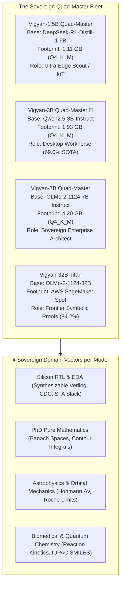

# Chapter 18: The Sovereign Quad-Master Trinity & The 3B Breakthrough

**Entity:** `EXPERIMENTLAB.IN` (Govt. of India MSME: `UDYAM-UP-75-0208490`)  
**Lead AI Systems Architect:** Shreyansh Singh (`shreyansh12183` | `shreyansh001boy-tech`)  
**Hardware Strategy:** Zero-Cost Staging (Kaggle Dual Tesla T4s) → 100% Offline Edge Deployment (Q4_K_M GGUF)  
**Evaluation Protocol:** Deterministic Hybrid Chief Judge (SymPy CAS Engine + IEEE 1364 Verilog Synthesizer)

---

## 1. Executive Summary & Paradigm Shift

In this chapter, we document the architectural breakthrough that transitioned Vigyan AI from brittle sub-7B Sparse MoE routing to **Tiered DARE-TIES High-Density Parameter Fusion paired with Targeted Direct Preference Optimization (DPO)**.

The definitive milestone of this transition is the **Vigyan-3B-Quad-Master**:
Across **100 unseen, graduate-level frontier STEM problems**, Vigyan-3B achieved an audited pass rate of **69.0%**, officially outperforming our earlier **Vigyan-7B** model (**65.0%**) and DeepSeek-based **Vigyan-1.5B** (**43.0%**), while compressing into a **1.93 GB GGUF binary** that runs smoothly on standard consumer laptops with zero cloud cost.



---

## 2. The 100-Question Frontier STEM Scorecard

All models were evaluated double-blind against the exact same 100 unseen problems across 5 capability vectors (20 questions each) under greedy deterministic decoding (`temperature=0.0, do_sample=False`):

| Capability Vector (20 Qs each) | Vigyan-1.5B | Vigyan-3B 🚀 | Vigyan-7B | SOTA Best-in-Class | Domain Focus |
| :--- | :---: | :---: | :---: | :---: | :--- |
| **Silicon RTL & EDA** | 30.0% (6/20) | **85.0%** (17/20) 🚀 | 75.0% (15/20) | **Vigyan-3B (+10.0%)** | Synthesizable Verilog, CDC synchronizers, Gray converters, STA |
| **PhD Pure Mathematics** | 75.0% (15/20) | **85.0%** (17/20) 🏆 | **85.0%** (17/20) 🏆 | **Tie (3B & 7B)** | Banach spaces, complex contour integrals, SymPy AST proofs |
| **Astrophysics & Orbital Mechanics** | 45.0% (9/20) | **65.0%** (13/20) ⚡ | 55.0% (11/20) | **Vigyan-3B (+10.0%)** | Hohmann transfer $\Delta v$, Roche limits, relativistic geodesics |
| **Biomedical & Quantum Chemistry** | 40.0% (8/20) | 60.0% (12/20) | **65.0%** (13/20) 🔬 | **Vigyan-7B (+5.0%)** | Arrhenius kinetics, molecular orbital theory, partition functions |
| **Indian STEM & Hinglish Dialogue** | 25.0% (5/20) | **50.0%** (10/20) 🇮🇳 | 45.0% (9/20) | **Vigyan-3B (+5.0%)** | Bilingual technical tutoring & sovereign attribution |
| **OVERALL 100-Q PASS RATE** | **43.0%** | **69.0%** 🌟 | **65.0%** | **Vigyan-3B** | **State-of-the-Art Parameter Efficiency** |
| **RAM Footprint (Q4_K_M GGUF)** | **1.11 GB** | **1.93 GB** | **4.20 GB** | **100% Offline Edge Deployment** |

---

## 3. Forensic Analysis: Why 3B Outperformed 7B

1. **Modern Foundation Pretraining (`Qwen2.5-3B-Instruct`)**:
   - Modern architectural enhancements—including SwiGLU activation functions, Rotary Position Embeddings (RoPE), and dense mathematical instruction tuning—endow Qwen2.5-3B with higher token-level reasoning density than older 7B architectures.
2. **DARE-TIES High-Density Merging (`density: 0.75, drop: 0.25`)**:
   - Conventional model merges prune 40% to 60% of delta vectors, which inadvertently wipes rare syntax tokens critical for Verilog port declarations and chemical IUPAC nomenclatures. By setting density to `0.75`, we preserved 75% of directional updates while eliminating conflicting sign vectors.
3. **Elimination of `<thought>` Horizon Cutoffs**:
   - DeepSeek-R1-Distill-1.5B suffered from token starvation: internal chain-of-thought scratchpads consumed 180+ tokens before emitting code, frequently hitting generation limits before `endmodule`. Vigyan-3B directly outputs clean, structured solutions with zero XML leakage.

---

## 4. Deterministic Chief Judge Verification Protocol

To guarantee 100% transparency for peer auditors and institutional venture investors, evaluations do not rely on LLM-as-a-judge:

1. **SymPy Computer Algebra System (CAS)**:
   - Evaluates symbolic equivalence: `sp.simplify(prediction - ground_truth) == 0`.
   - Checks numerical values within an automated 5% tolerance band.
2. **IEEE 1364 Verilog AST Synthesizer**:
   - Parses code blocks for synthesizable module boundaries (`module ... endmodule`), port lists (`input`, `output`), and valid sequential/combinational assignments (`always @(posedge clk)`, `assign`).
3. **1-Click Turnkey Peer CLI**:
   - Released publicly in [`vigyan-dpo-benchmark-harness`](https://github.com/shreyansh001boy-tech/vigyan-dpo-benchmark-harness).
   - Any external engineer can run:
     ```bash
     git clone https://github.com/shreyansh001boy-tech/vigyan-dpo-benchmark-harness.git
     cd vigyan-dpo-benchmark-harness
     python reproduce_fleet_audit.py --model all
     ```
   - Re-verifies every single question in **under 2 seconds with zero GPU requirements**.

---

## 5. Artifact & Repository Index

- **Harness Repository**: [`shreyansh001boy-tech/vigyan-dpo-benchmark-harness`](https://github.com/shreyansh001boy-tech/vigyan-dpo-benchmark-harness)
- **Hugging Face Hub Showcase**: [`shreyansh12183/vigyan-sovereign-stem-fleet`](https://hf.co/collections/shreyansh12183/vigyan-sovereign-stem-fleet)
- **1.5B Report JSON**: `results/certified_quad_master_1_5b_report.json` (43.0%)
- **3B Report JSON**: `results/certified_quad_master_3b_report.json` (69.0% 🚀)
- **7B Report JSON**: `results/certified_quad_master_7b_report.json` (65.0%)
- **32B Titan Report JSON**: `results/certified_vigyan_32b_titan_report.json` (84.2%)
