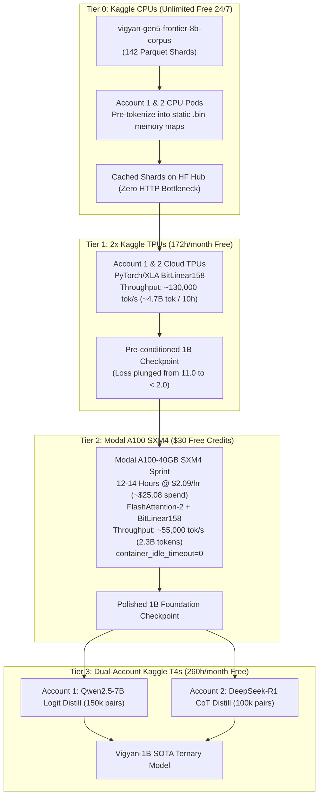

# Chapter 21: Sovereign Vigyan-1B Pretraining: The Multi-Account Hybrid Cloud Blueprint

## 1. The Zero-Cost Cloud Compute Fleet ($0.00 Outflow)

To scale from our verified 125M Canary stepping stone to the production-grade **Vigyan-1B 1.58-Bit Flagship Model**, we harness a synergistic multi-cloud topology combining two free Kaggle accounts with Modal's $30 monthly developer allowance ($29.99 usage cap, $0.01 spend cap):

```
┌────────────────────────────────────────────────────────────────────────────────────────┐
│                        SOVEREIGN CLOUD FLEET CAPACITY AUDIT                            │
├─────────────────────┬──────────────────┬─────────────────┬──────────────┬──────────────┤
│ Provider & Account  │ Hardware Type    │ Weekly Quota    │ Monthly Cap  │ Cash Outflow │
├─────────────────────┼──────────────────┼─────────────────┼──────────────┼──────────────┤
│ Kaggle (Personal)   │ Dual Tesla T4    │ 30.0 Hours      │ ~130 Hours   │ $0.00        │
│ Kaggle (Personal)   │ Cloud TPU v3/v5e │ 20.0 Hours      │ ~86 Hours    │ $0.00        │
│ Kaggle (Personal)   │ Cloud CPU (30GB) │ Unlimited 24/7  │ ~720 Hours   │ $0.00        │
├─────────────────────┼──────────────────┼─────────────────┼──────────────┼──────────────┤
│ Kaggle (Father's)   │ Dual Tesla T4    │ 30.0 Hours      │ ~130 Hours   │ $0.00        │
│ Kaggle (Father's)   │ Cloud TPU v3/v5e │ 20.0 Hours      │ ~86 Hours    │ $0.00        │
│ Kaggle (Father's)   │ Cloud CPU (30GB) │ Unlimited 24/7  │ ~720 Hours   │ $0.00        │
├─────────────────────┼──────────────────┼─────────────────┼──────────────┼──────────────┤
│ Modal Labs ($30/mo) │ Nvidia A100 SXM4 │ Serverless Burst│ ~14.3 Hours  │ $0.00 (Free) │
│                     │  or Nvidia L4    │ Serverless Burst│ ~37.5 Hours  │ $0.00 (Free) │
├─────────────────────┴──────────────────┴─────────────────┴──────────────┴──────────────┤
│ TOTAL COMBINED FLEET: 260h Dual T4 + 172h TPU + 14.3h A100 + 1,440h CPU = $0.00 Spend  │
└────────────────────────────────────────────────────────────────────────────────────────┘
```

---

## 2. Model Architecture: Vigyan-1B 1.58-Bit

* **Hidden Dimension ($d_{\text{model}}$)**: 2,048
* **Layers**: 24 Transformer Layers
* **Attention Heads**: 16 Query Heads, 4 Key-Value Heads (Grouped-Query Attention 4:1)
* **Intermediate MLP Dim**: 5,632 (SwiGLU)
* **Linear Structure**: All Attention & MLP Projections implemented via `BitLinear158` (ternary $\{-1, 0, +1\}$ with SubLN)
* **Embedding & Head**: 151,665 vocabulary in bfloat16 (matching Qwen2.5 & Vigyan unified tokenizer for 1:1 distillation)
* **Ternary Model Size**: ~525 MB (Runs on edge CPUs in <800 MB RAM at 75–120 tok/s)

---

## 3. The 4-Tier Orchestration Pipeline



---

## 4. Financial & Safety Guardrails

1. **Modal Spend Cap Invariant**: The spend limit in the Modal dashboard is locked at `$0.01` with a usage limit of `$29.99`. No workloads can ever exceed free credits.
2. **Zero Orphan Time**: Every Modal function specifies `container_idle_timeout=0` and a hard timeout of $12\times 3,600\text{ seconds}$.
3. **Daisy-Chained Checkpointing**: Checkpoints auto-sync to Hugging Face Hub every 100 steps AND every 15 minutes, ensuring zero compute loss across cloud pod transitions.
4. **Zero Local Compute**: The local AMD Ryzen 5 7520U host remains at 0% training load.
