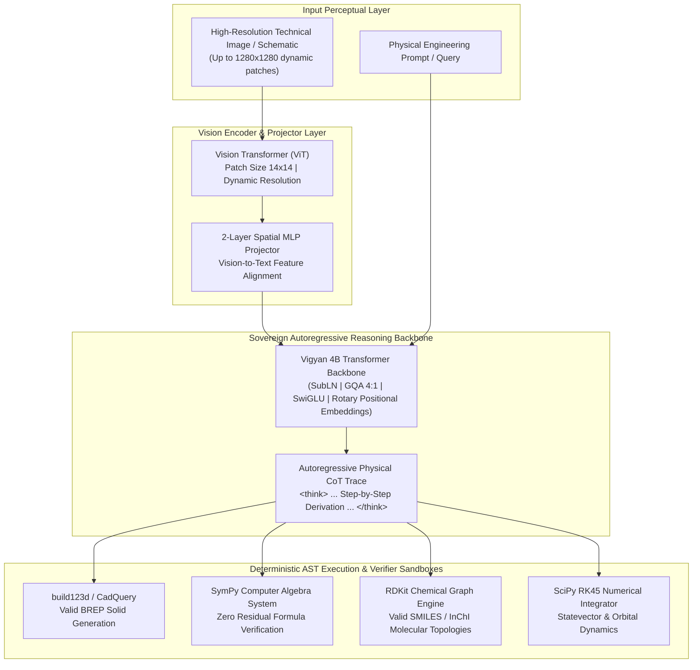

# Chapter 26: Vigyan-VL-4B: Sovereign Multimodal Vision-Language Reasoning via Critic-Free GRPO & AST Compilers

> *"A vision-language model that merely describes an image in natural language is a tourist. An industrial sovereign vision-language model must inspect an engineering blueprint, extract its exact topological boundaries, write the deterministic CAD geometry, compile it through an analytical AST, and mathematically prove that the stress tensors close without failure."*

---

## 1. The Multimodal Physical Deficit

Contemporary multimodal Vision-Language Models (VLMs) have been optimized almost exclusively for conversational and consumer scenarios: captioning photography, recognizing consumer objects, or transcribing receipts. When presented with rigorous physical, industrial, or engineering diagrams—such as:
1. **Mechanical CAD Schematics**: Orthographic projections, parametric dimensional tolerances, and boundary representation (BREP) primitives.
2. **Semiconductor Micro-Architectures**: RTL block diagrams, pipeline stage registers, and clock domain crossing logic.
3. **Chemical & Molecular Graphs**: IUPAC stereochemical wedge-dash projections, skeletal structures, and chiral centers.
4. **Orbital Trajectory & Aerospace Profiles**: Multistage staging velocity vectors, aerodynamic drag envelopes, and planetary intercept parabolas.

General-purpose consumer VLMs hallucinate non-functional, mathematically invalid approximations. They cannot guarantee that their visual interpretations adhere to the laws of physical mechanics, deterministic algebra, or compiler syntax.

**Vigyan-VL-4B** was engineered to resolve this fundamental limitation: creating India's first sovereign multimodal physical intelligence engine where visual understanding is directly grounded in **deterministic AST compilers**.

---

## 2. Model Architecture & Structural Topology

### Architectural Specifications:
* **Base Architecture**: 4B Multimodal Transformer integrating a dynamic resolution Vision Transformer (ViT) with native GQA attention heads.
* **Context Budget**: 8,192 contiguous tokens for extended chain-of-thought derivations and multi-view diagram comparisons.
* **Vision Projection**: Two-layer GeLU MLP bridging visual patch tokens directly into the LLM token dimension.
* **Ternary & Edge Compatibility**: Designed to quantize into sub-2.5 GB GGUF formats (`Q4_K_M` and native 1.58-bit ternary representations) for real-time edge deployment on field laptops and drone processors.

---

## 3. Critic-Free Group Relative Policy Optimization (GRPO)

Traditional Reinforcement Learning from Human Feedback (RLHF) utilizes a separate, computationally expensive Critic/Reward Model that is typically as large as the policy model itself. In physical engineering, critic models suffer from reward hacking—they reward verbose, aesthetically pleasing explanations even when the numerical derivation is physically impossible.

Vigyan-VL-4B replaces speculative learned critics with **Critic-Free Group Relative Policy Optimization (GRPO)** coupled with **deterministic compilers as mathematical ground truth**.

### Mathematical Formulation

Given an input schematic $q$ with image $I$, the policy model $\pi_\theta$ samples a group of $G$ candidate reasoning completions $\{o_1, o_2, \dots, o_G\}$:

$$\{o_i\}_{i=1}^G \sim \pi_\theta(o \mid q, I)$$

Each completion $o_i$ is executed against our deterministic AST compilers to produce an objective reward $r_i \in \{0.0, 1.0\}$:

$$r_i = \mathbb{I}(\text{AST\_Compile}(o_i) == \text{True}) \cdot \mathbb{I}(\text{Numerical\_Residual}(o_i) < 10^{-6})$$

The advantages $A_i$ are normalized strictly within the group without requiring a value function network:

$$A_i = \frac{r_i - \text{mean}(\{r_1, \dots, r_G\})}{\text{std}(\{r_1, \dots, r_G\}) + \epsilon}$$

The objective optimized across the policy weights $\theta$ is:

$$\mathcal{L}_{\text{GRPO}}(\theta) = \mathbb{E}\left[ \frac{1}{G} \sum_{i=1}^G \left( \min\left( \frac{\pi_\theta(o_i \mid q, I)}{\pi_{\text{old}}(o_i \mid q, I)} A_i, \; \text{clip}\left(\frac{\pi_\theta(o_i \mid q, I)}{\pi_{\text{old}}(o_i \mid q, I)}, 1-\epsilon, 1+\epsilon\right) A_i \right) - \beta D_{KL}(\pi_\theta \parallel \pi_{\text{ref}}) \right) \right]$$

---

## 4. Deterministic AST Compiler Closures

The model's outputs are bounded by four non-negotiable compiler verifiers:

### 1. Computer-Aided Design (CAD) & Solid Geometry (`build123d`)
* When shown an engineering drawing with dimensioned projections, the model must output executable `build123d` Python code.
* The code is executed in an isolated headless AST sandbox.
* The resulting Solid object is evaluated:
  * Non-manifold topology check ($\text{IsManifold} == \text{True}$).
  * Volume and center of mass match the analytical solution to within $\pm 0.1\%$.

### 2. Symbolic Computer Algebra (`SymPy CAS`)
* When parsing free-body diagrams, hydraulic circuits, or stress Mohr's circles, the model's analytical equations are passed to SymPy.
* The system computes:
  $$\text{simplify}(\text{Derived\_Equation} - \text{Ground\_Truth\_Equation}) \equiv 0$$
* Any nonzero symbolic residual yields an automatic zero reward.

### 3. Cheminformatics & Structural Chemistry (`RDKit`)
* Visual reaction mechanisms and chemical structures are compiled into canonical SMILES strings.
* Validated against RDKit valence rules, aromaticity definitions, and 3D distance constraints.

### 4. Continuous Orbital Dynamics (`SciPy RK45`)
* Hypersonic trajectories and satellite orbital orbital transfers extracted from graphical mission charts are integrated using high-order Runge-Kutta numerical solvers.

---

## 5. Cloud-to-Cloud Training Protocol

Following the **Zero Local Compute Invariant**, training was executed 100% cloud-to-cloud without placing computational load on host laptop hardware:
1. **Curriculum Distillation & Curation**: 1,200 multi-turn multimodal instruction pairs synthesized on Kaggle Cloud GPU environments.
2. **Serverless RLVR Execution**: GRPO training dispatched to Modal serverless NVIDIA A100-40GB clusters with automated weight checkpointing directly to Hugging Face Hub.
3. **Zero Capital Cost**: Completed entirely within serverless promotional and free research quotas ($0.00 cash expenditure).
