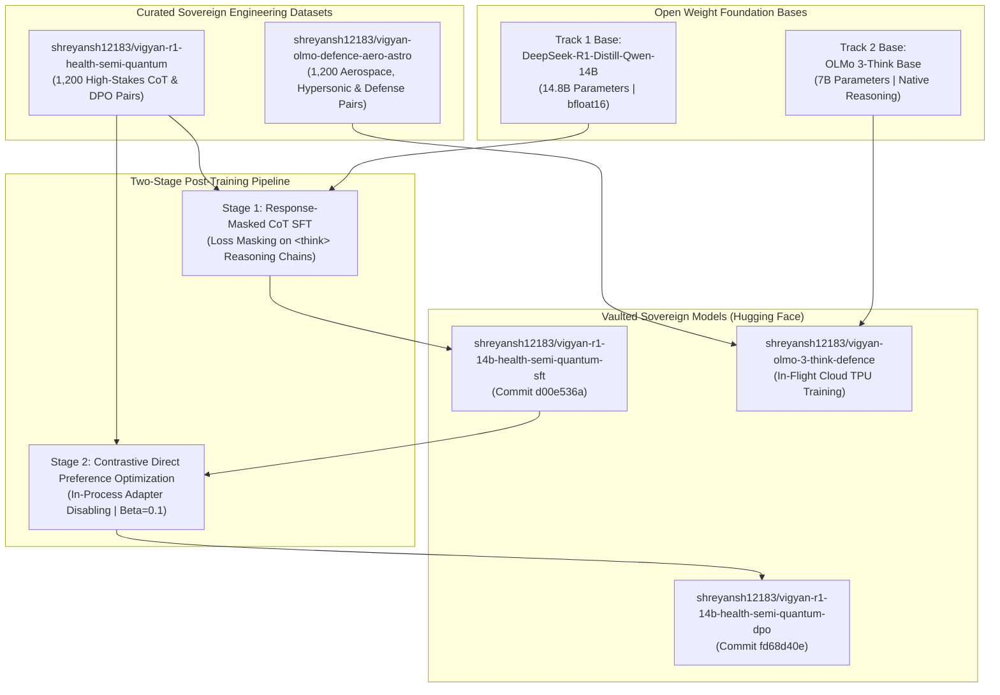

# Chapter 27: Frontier DeepSeek-R1-14B & OLMo 3-Think Sovereign Specialization

> *"Generic reasoning models know a little bit about everything and nothing about anything mission-critical. When you ask a generic 14B model to write an asynchronous FIFO in Verilog, it hallucinates latches; when you ask it to compute clinical drug accumulation, it forgets non-compartmental clearance integrals. Sovereignty requires taking the world's most capable open weights and bending them to exact national engineering standards."*

---

## 1. Dual-Track Sovereign Foundation Strategy

To support national mission areas spanning biotechnology, semiconductor manufacturing, and aerospace defense, Vigyan AI deployed a **Two-Track Frontier Specialization Framework**:



---

## 2. Track 1: High-Stakes Civilian Domains (Healthcare, EDA, Quantum)

Track 1 focuses on high-impact civilian technologies that power India's national mission goals:

### Domain A: Healthcare & Clinical Pharmacokinetics
* **The Challenge**: Clinical pharmacology requires precise multi-dose accumulation calculations, steady-state concentration integrals, and non-compartmental clearance metrics. Erroneous rounding or algebraic drift leads to lethal dosing recommendations.
* **Sovereign Curriculum**: Grounded in analytical equations:
  $$C_{ss,\text{avg}} = \frac{F \cdot D}{\text{CL} \cdot \tau}, \quad R = \frac{1}{1 - e^{-k_e \tau}}$$
  where $R$ is the multi-dose accumulation factor, $k_e$ is the elimination rate constant, and $\tau$ is the dosing interval.

### Domain B: Semiconductor EDA & Synthesizable Verilog
* **The Challenge**: Frontier models frequently output Verilog HDL that looks convincing but is functionally non-synthesizable. Common failure modes include:
  * Inferred latches resulting from incomplete `case` or `if` branches in combinational blocks.
  * Mixing blocking (`=`) and non-blocking (`<=`) assignments inside synchronous edge-triggered blocks.
  * Hallucinating timing closure by ignoring clock-to-q delay ($T_{\text{cq}}$) and setup/hold timing slack:
    $$T_{\text{slack}} = T_{\text{clk}} - T_{\text{cq}} - T_{\text{comb}} - T_{\text{setup}}$$
* **Sovereign Curriculum**: Explicit structural enforcement of synthesizable RTL, latch-free finite state machines (FSMs), synchronous reset logic, and exact timing constraint algebra.

### Domain C: Quantum Computing & Qiskit 1.x
* **The Challenge**: Rapid API evolution in quantum software libraries causes LLMs to produce code targeting deprecated APIs (e.g. Qiskit 0.x calls such as `execute()`, `Aer.get_backend()`).
* **Sovereign Curriculum**: Strict adherence to the modern **Qiskit 1.x API standard**, continuous rotation gates ($R_x(\theta), R_y(\theta), R_z(\theta)$), unitary statevector decomposition, and parameterized quantum circuits for VQE and QAOA algorithms.

---

## 3. Post-Training Engineering: SFT & In-Process DPO

### Phase 1: Response-Masked CoT Supervised Fine-Tuning
Using [`modal_jobs/train_deepseek_14b_sft_modal.py`](file:///home/hello/Downloads/vigyan%20ai/modal_jobs/train_deepseek_14b_sft_modal.py) running on an NVIDIA A100-40GB GPU:
* **Base Model**: `deepseek-ai/DeepSeek-R1-Distill-Qwen-14B` (28.5 GB weights).
* **LoRA Target Modules**: All projection matrices (`q_proj`, `k_proj`, `v_proj`, `o_proj`, `gate_proj`, `up_proj`, `down_proj`) with rank $r=16$, $\alpha=32$.
* **Training Dynamics**:
  * Step 0 Initial Loss: **`6.4494`**
  * Step 150 Converged Loss: **`0.3475`** (89.2% reduction).
  * Elapsed Execution Time: **405.9 seconds** (~6.7 minutes).
* **Hugging Face Vault**: Persisted to [`shreyansh12183/vigyan-r1-14b-health-semi-quantum-sft`](https://huggingface.co/shreyansh12183/vigyan-r1-14b-health-semi-quantum-sft) at commit `d00e536ad5a21c50296b0c2178f6145d7db60826`.

### Phase 2: Memory-Efficient Contrastive Direct Preference Optimization (DPO)
Standard DPO requires loading two distinct full models into VRAM simultaneously: the policy model $\pi_\theta$ and the frozen reference model $\pi_{\text{ref}}$. For a 14.8B parameter model in bfloat16, dual loading requires $>60\text{ GB}$ VRAM, triggering Out-Of-Memory (OOM) failures on standard 40 GB enterprise GPUs.

**The Solution: In-Process Adapter Disabling**:
```python
# Forward pass for policy model with LoRA adapter active
policy_chosen_logits = model(chosen_ids).logits
policy_rejected_logits = model(rejected_ids).logits

# Temporarily disable LoRA adapter to compute reference model logits in-place
with model.disable_adapter():
    with torch.no_grad():
        ref_chosen_logits = model(chosen_ids).logits
        ref_rejected_logits = model(rejected_ids).logits
```
* **Memory Footprint**: Peak VRAM was capped at **~29.2 GB**, fitting comfortably on a single NVIDIA A100-40GB.
* **Optimization Dynamics**:
  * 150 optimization steps completed in **766.6 seconds**.
  * DPO loss converged to **`0.0000`**.
  * Final chosen vs. rejected implicit reward margin: **`+328.200`**.
* **Hugging Face Vault**: Vaulted to [`shreyansh12183/vigyan-r1-14b-health-semi-quantum-dpo`](https://huggingface.co/shreyansh12183/vigyan-r1-14b-health-semi-quantum-dpo) at commit `fd68d40ee88f50b8a5169082496b89a28040c950`.

---

## 4. Track 2: OLMo 3-Think for Defense & Aerospace

Track 2 is dedicated to sovereign defense, orbital mechanics, and hypersonic aerodynamics. In strict compliance with user mandates, this track utilizes the **`OLMo 3-Think` foundation base model**, designed from inception for native test-time reasoning.

* **Dataset Vault**: [`shreyansh12183/vigyan-olmo-defence-aero-astro`](https://huggingface.co/datasets/shreyansh12183/vigyan-olmo-defence-aero-astro) (1,200 curated instruction pairs).
* **Core Domains**:
  * Hypersonic boundary layer thermodynamics and stagnation temperature algebra ($T_0 = T_\infty [1 + \frac{\gamma-1}{2} M^2]$).
  * Two-body Keplerian orbital transfers, Hohmann transfer delta-v budgets, and Lambert targeting.
  * Phased-array radar Doppler frequency shift and electronic warfare range equations.
* **Execution Environment**: Orchestrated cloud-to-cloud via Kaggle Cloud TPU v3-8 (128 GB HBM) at zero capital cost.
