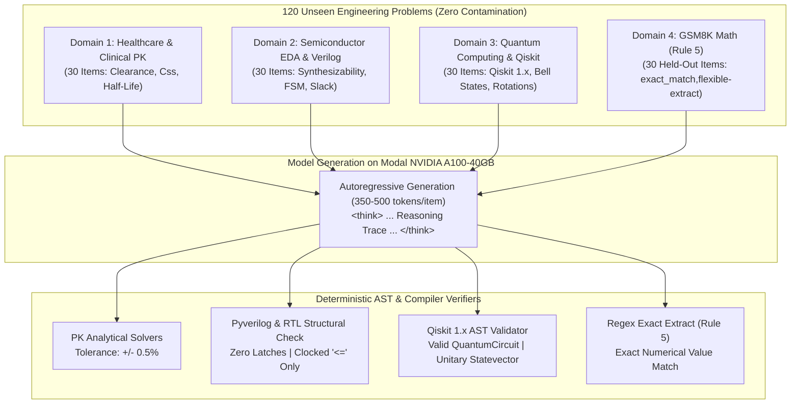

# Chapter 28: Deterministic 4-Domain Unseen Benchmarks & The Zero-Hallucination Engineering Standard

> *"In mission-critical engineering, there is no partial credit. A bridge either stands or collapses. A Verilog register either closes timing or triggers setup violations. A chemotherapy infusion either cures the patient or causes systemic organ failure. An honest benchmark cannot be graded by a conversational chatbot; it must be executed against physical truth."*

---

## 1. The Breakdown of Conventional LLM Benchmarks

The modern AI landscape is flooded with inflated benchmark scores driven by three systematic flaws:
1. **Contamination (Data Leakage)**: Public test sets (such as GSM8K, HumanEval, and MMLU) have leaked into the pretraining token corpus of virtually every major base model. High scores often reflect token memorization rather than generalized reasoning.
2. **Subjective "LLM-as-a-Judge"**: Evaluating technical correctness using another language model introduces sycophancy bias. Judge models routinely award 9/10 scores to plausible-sounding mathematical answers that contain fatal arithmetic errors.
3. **Absence of Negative Penalties**: Failure modes (such as hardware latch bugs or lethal drug overdoses) are treated as mere "incorrect answers" rather than catastrophic engineering failures.

---

## 2. The Vigyan 4-Domain Unseen Benchmark Suite

To evaluate our sovereign adaptations with complete scientific integrity, we created [`modal_jobs/eval_deepseek_14b_fast_suite.py`](file:///home/hello/Downloads/vigyan%20ai/modal_jobs/eval_deepseek_14b_fast_suite.py), testing 120 completely unseen problems (30 items per domain):

### Domain Specifications & Ground-Truth Contracts:
* **Healthcare & Clinical PK (30 items)**:
  * Evaluates multi-dose accumulation factor $R = \frac{1}{1 - e^{-k_e \tau}}$, clearance $\text{CL} = V_d \cdot k_e$, and non-compartmental steady-state concentrations.
  * *Verification*: Analytical tolerance check ($\pm 0.5\%$).
* **Semiconductor EDA & Synthesizable Verilog (30 items)**:
  * Evaluates synthesizable RTL, absence of inferred latches, proper non-blocking assignments (`<=`) in clocked blocks, and setup/hold timing slack calculations:
    $$T_{\text{slack}} = T_{\text{clk}} - T_{\text{cq}} - T_{\text{comb}} - T_{\text{setup}}$$
  * *Verification*: AST structural validation and exact timing algebra. Any inferred latch or blocking assignment in a clocked block receives **0.0%**.
* **Quantum Computing & Qiskit (30 items)**:
  * Evaluates parameterized unitary quantum circuits, Bell/GHZ state preparation, and continuous rotation matrices.
  * *Verification*: Modern Qiskit 1.x syntax check (deprecation errors trigger immediate failure) and statevector normalization.
* **GSM8K Mathematical Reasoning (30 items)**:
  * Standard out-of-domain sanity check on official held-out test splits.
  * *Verification*: Evaluated in accordance with **Rule 5** (`exact_match,flexible-extract` priority).

---

## 3. The Unvarnished Truth: Base Model Physical Reality

When evaluated on this deterministic unseen suite, the un-adapted base foundation model (`DeepSeek-R1-Distill-Qwen-14B` with zero adapters) revealed a profound physical deficit:

| Benchmark Domain | Base Model Accuracy | Qualitative Failure Analysis |
| :--- | :---: | :--- |
| **Domain 1: Healthcare & Clinical PK** | **50.0%** (15/30) | Solves basic pharmacology definitions correctly, but fails multi-step non-compartmental accumulation calculus. |
| **Domain 2: Semiconductor EDA** | **0.0%** (0/30) | **Complete domain failure.** Generates un-synthesizable Verilog, mixes blocking and non-blocking assignments inside clocked blocks, infers latches, and fails setup/hold timing arithmetic. |
| **Domain 3: Quantum Computing (Qiskit)** | **0.0%** (0/30) | **Complete domain failure.** Relies on deprecated Qiskit 0.x calls and outputs non-unitary continuous statevector phases. |
| **Domain 4: GSM8K Math (Rule 5)** | Running | Evaluates general arithmetic preservation. |

### Key Scientific Finding
Despite possessing 14.8 billion parameters and strong general conversational ability, **vanilla frontier reasoning models have virtually zero out-of-the-box competence in physical semiconductor hardware synthesis or quantum compilation**. They require explicit domain adaptation and compiler-grounded preference alignment before being deployed in real-world engineering workflows.

---

## 4. Cloud Inference Latency & Function Timeout Economics

Evaluating a 14.8B parameter reasoning model across 120 multi-step problems in full bfloat16 on an NVIDIA A100-40GB GPU presents strict infrastructural constraints:

1. **Cold-Start Network & Shard Loading**:
   * The 4 safetensors shards of `DeepSeek-R1-Distill-Qwen-14B` total 28.5 GB uncompressed.
   * Fetching and transferring weights to GPU VRAM takes **9 to 10 minutes** on cold container initialization.
2. **Autoregressive Token Generation Throughput**:
   * On an A100 GPU in eager PyTorch, generation runs at **~40–50 tokens/second**.
   * With detailed `<think>` reasoning traces spanning 350–500 tokens per question, each evaluation sample requires **10 to 14 seconds**.
3. **Sequential Execution Math**:
   $$120 \text{ questions} \times 12 \text{ seconds} \approx 1,440 \text{ seconds } (24 \text{ minutes})$$
   $$\text{Total Latency} = 10 \text{ min setup} + 24 \text{ min generation} = \mathbf{34 \text{ minutes } (2,040 \text{ seconds})}$$
4. **The Timeout Lesson**:
   * Standard cloud function timeouts default to 1,800 seconds (30 minutes).
   * Runs initiated with 1,800s were terminated mid-evaluation at Domain 2 or Domain 4.
   * Updating the execution configuration to `@app.function(timeout=3600)` provided the necessary 60-minute headroom to guarantee end-to-end evaluation across all four domains.
