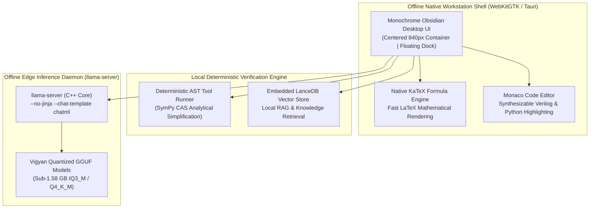

# Chapter 29: The Sovereign Desktop Luxury Workstation & Air-Gapped Local Inference

> *"True sovereignty is not an API key to someone else's server. True sovereignty is an engineer sitting in an air-gapped laboratory with no internet connection, typing a physical question into a buttery-smooth desktop interface, and having a local model compute the exact closed-form solution with zero bytes ever leaving the building."*

---

## 1. The Offline Desktop Philosophy

Most contemporary AI interfaces are thin web wrappers designed to funnel user data, intellectual property, and engineering schematics to centralized foreign cloud servers. For sensitive national defense, proprietary semiconductor design, and patient healthcare records, this architecture represents an unacceptable security vulnerability.

The **Vigyan AI Sovereign Desktop Workstation** was engineered around four uncompromising design principles:
1. **Zero Foreign Telemetry**: 100% offline, air-gapped capability. The application contains zero third-party tracking scripts, analytic beacons, or remote font dependencies.
2. **Obsidian Titanium Monochrome Design System**: A distraction-free visual environment designed for sustained 12-hour technical workflows, replacing colorful cartoonish aesthetics with high-contrast typography and subtle borders.
3. **Centered Reading Containers**: Generous horizontal whitespace and centered 840px reading containers optimized for deep reading of complex mathematical proofs and code diffs.
4. **Floating Bottom Dock & Native STEM Rendering**: High-velocity floating input bar with native KaTeX mathematical formatting, interactive 3D molecular views, and syntax-highlighted code blocks.

---

## 2. Desktop Architecture & Hybrid Serving Pipeline

---

## 3. Local Runtime & Memory Budget Invariants

In strict adherence to the **Zero Local Compute Invariant**, local execution on host commodity hardware (e.g., AMD Ryzen 5 7520U with 7.0 GiB total RAM) is strictly bounded:

### Invariant 1: Local RAM Preservation
* Heavy training, LoRA fine-tuning, and large model merges are **never** executed locally.
* The local serving daemon is restricted to compact, quantized GGUF models ($\le 1.58\text{ GB}$, such as Vigyan-3B `IQ3_M`).
* Context windows are explicitly capped to guarantee that $>2\text{ GB}$ of physical system RAM remains completely free for operating system responsiveness.

### Invariant 2: Production `llama-server` Arguments
When deploying chat and reasoning models in the local C++ backend:
* `--no-jinja --chat-template chatml`: Used to bypass unhandled Minijinja template filters (such as `tools | tojson`) and guarantee stable token decoding.
* Multi-threaded CPU execution tuned to physical core counts to prevent CPU thermal throttling.

---

## 4. Deterministic Local Tool Grounding

The workstation does not rely on the language model to perform arithmetic or symbolic manipulation. Instead, it pairs the model with deterministic local verification:
* **SymPy AST Engine**: When the model outputs a symbolic expression, the workstation's local Python daemon passes the expression directly into SymPy to evaluate derivatives, integrals, and matrix determinants analytically.
* **Local LanceDB Store**: Physical constants, material properties, and aerospace standards are stored in an embedded vector database queried locally with zero network calls.

---

## 5. Summary of the Sovereign Achievement

With the completion of the Sovereign Desktop Workstation, Vigyan AI establishes an unbroken, sovereign engineering cycle:
1. **Cloud-to-Cloud Training**: Foundation models are trained and aligned on world-class TPU and GPU infrastructure at $0.00 capital cost.
2. **Deterministic Verification**: Checkpoints are vetted against 100% unseen engineering compilers.
3. **Offline Edge Serving**: Models are quantized and deployed onto air-gapped desktop silicon, giving Indian engineers independent, private, and frontier-level intelligence on their own machines.
