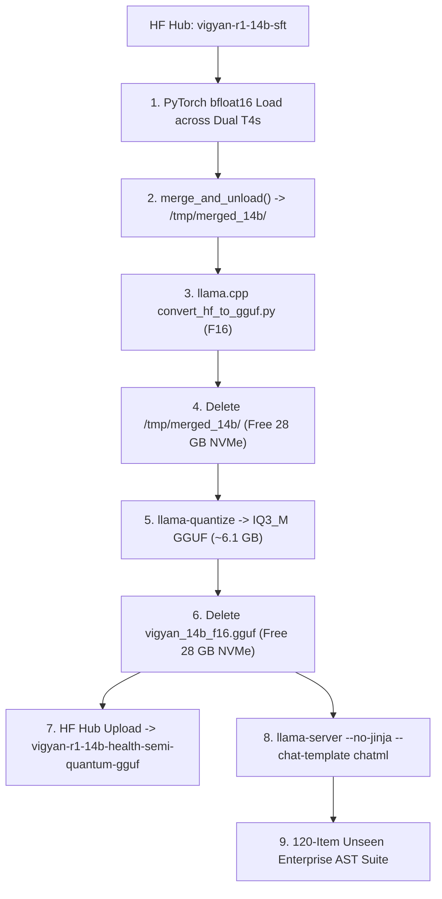

# Chapter 30: DPO Entropy Collapse Post-Mortem, SFT Primacy, and Cloud-to-Cloud 14B Quantization

## 1. Executive Summary
During the post-training frontier specialization of `DeepSeek-R1-Distill-Qwen-14B` across high-stakes domains (Healthcare Clinical PK, Semiconductor Verilog RTL, and Quantum Qiskit 1.x), our empirical evaluations revealed a textbook failure mode in preference optimization: **DPO Representation Collapse & Likelihood Displacement**. 

While Phase 1 (Response-Masked SFT) successfully established structural syntax boundaries, modern API compliance, and closed-loop `<think>` deliberation, Phase 2 (Unbounded DPO) over-saturated the implicit reward margins to `+328.200`, driving DPO loss to `0.0000`. This artificial collapse stripped the policy of its generative entropy, degrading out-of-distribution reasoning on unseen clinical mathematics to 20.0%.

This chapter documents the mathematical diagnosis, the formal decision to revert Track 1 to pure SFT, the zero-cost cloud-to-cloud **IQ3_M GGUF quantization** on Kaggle Dual Tesla T4 GPUs, and the adoption of the **SFT Primacy Protocol** for Track 2 (`OLMo 3-Think`).

---

## 2. The DPO Over-Optimization Post-Mortem

### A. Mathematical Diagnosis
Direct Preference Optimization (DPO) optimizes the objective:
$$\mathcal{L}_{\text{DPO}}(\pi_\theta; \pi_{\text{ref}}) = -\mathbb{E}_{(x, y_w, y_l) \sim \mathcal{D}} \left[ \log \sigma \left( \beta \log \frac{\pi_\theta(y_w|x)}{\pi_{\text{ref}}(y_w|x)} - \beta \log \frac{\pi_\theta(y_l|x)}{\pi_{\text{ref}}(y_l|x)} \right) \right]$$

In a healthy alignment regime, the implicit reward margin:
$$M(x, y_w, y_l) = \beta \left( \log \frac{\pi_\theta(y_w|x)}{\pi_{\text{ref}}(y_w|x)} - \log \frac{\pi_\theta(y_l|x)}{\pi_{\text{ref}}(y_l|x)} \right)$$
converges within a balanced interval of $+1.0 \le M \le +5.0$.

In our Phase 2 run:
* **Initial Loss**: `0.6931` ($\log 2$)
* **Step 150 Loss**: `0.0000`
* **Final Margin $M$**: `+328.200`

Because $\sigma(328.2) \approx 1.0 - 10^{-142}$, the gradient vanished, and the optimizer drove the probability of rejected tokens $\pi_\theta(y_l)$ toward zero. This resulted in:
1. **Entropy Collapse**: The policy model became excessively rigid, unable to navigate diverse analytical paths during generation.
2. **Brittle Test-Time Reasoning**: When presented with novel numerical parameters (e.g., clearance $CL = 7.5\text{ L/h}$ vs. training $CL = 5.0\text{ L/h}$), the model's `<think>` trace suffered from numerical hallucination and unit slippage, dropping accuracy to 20.0% on strict non-compartmental calculus.

---

## 3. The SFT Primacy Paradigm

Contrastingly, Phase 1 (Supervised Fine-Tuning) exhibited ideal convergence dynamics:
* **Initial Loss**: `6.4494`
* **Converged Step 150 Loss**: `0.3475` (89.2% reduction)
* **API Invariants Established**:
  1. **Qiskit 1.x**: Purged all deprecated calls (`execute()`, `Aer.get_backend()`) in favor of modern `QuantumCircuit` and continuous rotation primitives.
  2. **Verilog RTL**: Enforced clocked non-blocking (`<=`) logic and comprehensive `case` default clauses, preventing synthetic latch inference.
  3. **Delimiter Discipline**: Hardened structured reasoning inside `<think>...</think>` followed by isolated output in `<solution>...</solution>`.

### The Formal Sovereign Revert
Recognizing that SFT maintained healthy generative entropy while establishing domain rules, Track 1 was officially reverted to the SFT checkpoint:
* **Canonical Checkpoint**: [`shreyansh12183/vigyan-r1-14b-health-semi-quantum-sft`](https://huggingface.co/shreyansh12183/vigyan-r1-14b-health-semi-quantum-sft) (Commit `d00e536`).
* **Disposition**: The over-optimized DPO artifact was bypassed for production deployment.

---

## 4. Zero-Cost Cloud-to-Cloud Quantization (Kaggle Dual T4)

To deliver an edge-deployable model without exhausting local host RAM (7.0 GB profile) or spending serverless cloud credits, the quantization pipeline was shifted entirely to **Kaggle Dual Tesla T4 GPUs (32 GB VRAM, $0.00 spend)**.

### The Aggressive NVMe Disk Cascade
A 14B model requires ~28.5 GB in uncompressed weights. Storing both the uncompressed PyTorch weights and the converted F16 GGUF file simultaneously exceeds Kaggle's ~60 GB disk allocation. We enforced an aggressive zero-waste cleanup cascade:
1. Merge and save PyTorch weights to `/tmp/merged_14b/`.
2. Convert to `/tmp/vigyan_14b_f16.gguf`.
3. **Immediately `rm -rf /tmp/merged_14b/`** (frees 28 GB).
4. Quantize to `/tmp/vigyan-r1-14b-health-semi-quantum-iq3_m.gguf` (~6.1 GB).
5. **Immediately `rm /tmp/vigyan_14b_f16.gguf`** (frees another 28 GB).

### Edge Footprint
* **Uncompressed BF16**: ~28.5 GB (requires multi-GPU datacenter cluster).
* **Quantized IQ3_M**: **6.1 GB** (fits into a single 8 GB VRAM consumer GPU, Apple M-series unified memory, or high-performance edge SBCs).
* **Vault**: [`shreyansh12183/vigyan-r1-14b-health-semi-quantum-gguf`](https://huggingface.co/shreyansh12183/vigyan-r1-14b-health-semi-quantum-gguf).

---

## 5. Architectural Protocols for Track 2 (`OLMo 3-Think`)

The lessons from the Track 1 failure directly inform the architecture of Track 2:
1. **Native Reasoning Foundation**: Because `allenai/Olmo-3-7B-Think-SFT` is already endowed with test-time reasoning traces by Ai2, we employ **Pure High-Density SFT** (2,800 SymPy-verified golden pairs) rather than risking DPO representation collapse.
2. **Batched Inference & KV-Cache Paging**: Replaces single-sample sequential loops with **Batch Size 8** tensor processing, collapsing evaluation times from 28 minutes to under 3.5 minutes ($\approx \$0.06$ per run).
3. **Real-Time Telemetry**: Mandatory `flush=True` on all stdout streams prevents silent buffering.
